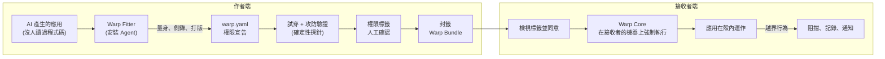

# SecureAIWarp

> 給「沒有人讀過程式碼」的 AI 應用一層可以被信任的**殼**。
> 殼由 AI Agent 量身安裝，但由確定性的核心強制執行，並用一張人看得懂的**權限標籤**交付給他人。

**狀態：第 1 期 MVP（v0.1.0-mvp），僅支援 Linux 的 `process` 隔離後端。** 核心 `warp` 已可側錄、檢查、強制執行、探測並產生標籤；
macOS、`container` 後端、AI 閘門、資料閘門、`survey`、`seal` 尚未實作（指令會明確回報，不會降級放行）。
實作與設計的差異、已知弱點見下方〈第 1 期實作狀態〉與 [09 路線圖](docs/09-roadmap.md)。核心做過一輪 AI 對抗式審查（見 [10](docs/10-security-review.md)），尚未經過獨立的人工安全審查，請勿用於高敏感用途。

---

## 一句話說明

現在的 AI 應用常常是這樣做出來的：多個 Agent 協作產生程式碼，人只做測試與功能驗證，不再逐行閱讀。
自己用沒問題；一旦要**交給別人用**，雙方都會開始擔心——

| 誰在擔心 | 擔心什麼 |
| --- | --- |
| 接收者 | 它會不會亂讀我的檔案？把資料傳到哪裡？會不會刪東西？會不會燒光我的 API 額度？ |
| 作者 | 我自己都沒看過程式碼，出事我要負責嗎？金鑰有沒有寫死在裡面？被人濫用怎麼辦？ |
| 組織 / IT | 這東西能不能進公司？依據是什麼？出事查得到紀錄嗎？ |

SecureAIWarp 的回答是：**既然程式碼不可信也沒人看，就不要把信任建立在程式碼上，而是建立在程式碼之外、它碰不到也改不了的邊界上。**

## 核心想法（五句話）

1. **管通道，不管型態。** 應用的介面與實作千變萬化，但它能影響世界的「通道」是有限的：檔案、程序、對外連線、對內連線、機密、AI 呼叫、資料、資源。殼只管這八條通道。
2. **Agent 提案，核心執行。** 因為應用太多樣，殼的設置交給 AI Agent；但 Agent 只能寫出一份宣告式的 `warp.yaml`，真正攔截行為的是一個小而固定、可人工稽核的核心（Warp Core）。Agent 寫錯，最壞結果是「功能不通」，而不是「殼被打穿」。
3. **測試就是規格。** 這群使用者本來就靠測試驗證功能——殼直接重用這些測試：在側錄模式下跑測試得到「它實際需要什麼」，據此產生最小權限；再在強制模式下重跑，證明「加了殼功能仍正常」。
4. **預設拒絕，憑證據授權。** 每一條權限都必須指向一筆側錄證據與一句人話用途。沒有證據的權限不給。
5. **人只看標籤。** 人不看程式碼，也不看 YAML，只看一張像營養標示的**權限標籤**，並對標籤的「差異」做決定。

## 整體流程



關鍵在右半邊：**強制執行發生在接收者自己的 Warp Core 上**。作者交出去的只是一份宣告（資料），不是執法者。接收者不需要相信作者，也不需要相信作者的 Agent。

## 文件導覽

| 文件 | 內容 |
| --- | --- |
| [01 問題與設計原則](docs/01-principles.md) | 為什麼需要殼、八條通道、七項設計原則、殼做不到的事 |
| [02 威脅模型](docs/02-threat-model.md) | 誰可能造成傷害、殼擋得住什麼、明確不處理什麼 |
| [03 架構](docs/03-architecture.md) | Warp Core 的元件、各通道的閘門、隔離後端 |
| [04 權限宣告規格](docs/04-manifest.md) | `warp.yaml` 的結構、檢查規則、風險分數 |
| [05 Agent 安裝協定](docs/05-agent-fitting-protocol.md) | Agent 如何替任意應用裝殼，以及如何防止 Agent 自己出錯或被騙 |
| [06 應用情境與覆蓋率](docs/06-scenarios.md) | CLI、桌面、Web、代管服務、MCP、自主 Agent 等九種情境的套用方式 |
| [07 標籤、封籤與交付](docs/07-label-and-distribution.md) | 權限標籤、信任等級、三種交付模式、版本更新 |
| [08 延伸構想](docs/08-ideas.md) | 試駕模式、後悔藥、保險絲等進一步的點子 |
| [09 路線圖與待決問題](docs/09-roadmap.md) | 分期、MVP 範圍、成功指標、尚未解決的問題 |
| [10 核心安全審查紀錄](docs/10-security-review.md) | 2026-11-25 的對抗式審查：已修補的漏洞、看過沒問題的地方、尚未處理的建議 |

另附：

- [`examples/invoice-helper.warp.yaml`](examples/invoice-helper.warp.yaml)：一份完整的權限宣告範例（含第 2 期才會強制的欄位）
- [`examples/notes-app/`](examples/notes-app/app.py)、[`examples/evil-app/`](examples/evil-app/app.py)：端對端測試用的正常與惡意範例應用
- [`skills/warp-fitter/SKILL.md`](skills/warp-fitter/SKILL.md)：給安裝 Agent 的操作手冊

## 建置與試用（Linux）

需求：Linux（建議 5.x 以上核心，允許建立使用者命名空間）、Go 1.24。核心是單一靜態執行檔，相依套件只有
`gopkg.in/yaml.v3` 與 `golang.org/x/sys`。

```bash
CGO_ENABLED=0 go build -o warp ./cmd/warp
./warp --version
```

以範例應用離線走一次 Agent 安裝流程（範例需要 `python3`）：

```bash
cd examples/notes-app
mkdir -p /tmp/notes && echo "hello" > /tmp/notes/a.txt
W=../../warp
$W init
$W record --pick notes=/tmp/notes -- python3 app.py count          # 側錄：讀取選定資料夾、寫入 APP_DATA
$W record -- python3 app.py serve --once                           # 側錄網頁介面：用終端機印出的網址開一次
$W draft                       # 由側錄紀錄產生 .warp/warp.yaml 初稿
$EDITOR .warp/warp.yaml        # 收緊、填寫每條 purpose；把 app.entry 改成正式啟動指令
$W lint                        # 硬性規則、證據檢核
$W enforce --pick notes=/tmp/notes -- python3 app.py count          # 強制模式
$W enforce -- python3 app.py serve --once                           # 會印出含一次性權杖的本機網址
$W probe                       # 在強制模式的殼內主動越界，每一項都必須被擋下
$W label                       # 權限標籤（終端機 + .warp/label.json）
$W evidence replay             # 重新執行每份證據的側錄指令，確認宣告的行為確實重現
$W ledger verify               # 驗證稽核帳本的雜湊鏈與尾端錨點
```

`summarize` 子指令會呼叫 `api.notes.example`（測試用保留網域），只在端對端測試的隔離網路中可用。

強制模式需要的機密真值由**執行 warp 的主機環境變數**提供（例如 `NOTES_API_KEY=... warp enforce ...`），
真值不會進入殼內；殼內只有佔位值，由對外閘門在送往綁定主機時注入標頭。

warp 不需要 root，也不需要 setuid 輔助程式：以一般使用者執行時，隔離與各閘門的保證與 root 相同（兩者都經端對端測試）；
唯一的差異是一般使用者通常沒有可用的 cgroup，記憶體上限會退為「每個程序」的 rlimit——核心會警告，標籤會以 ⚠ 標示。

測試：`go test ./...`。`e2e/` 的端對端測試需要 root（用 veth 建立與網際網路隔離的測試網路），會實際執行
[`examples/notes-app`](examples/notes-app/app.py)（正常應用）與 [`examples/evil-app`](examples/evil-app/app.py)
（刻意做壞事的應用），並從殼外驗證每一項攻擊都被擋下。每組測試各跑兩次：warp 以 root 執行一次，
再以一般使用者（root 建好測試網路與測試檔案後，以 `WARP_E2E_UID`（預設 47613）降權）執行一次；
`WARP_E2E_IDENTITIES=root` 或 `=user` 可只跑其中一種。

## 第 1 期實作狀態

| 項目 | 狀態 |
| --- | --- |
| `warp lint`：封閉格式、全部硬性規則、軟性規則警告、證據檢核（側錄檔綁定實際指令與內容雜湊並以本機金鑰簽章；擋不住同一使用者的偽造，見下） | 已實作 |
| `warp evidence replay`：不採信側錄檔，重新執行其中的指令確認行為；標籤列出每條授權的依據指令 | 已實作 |
| `process` 隔離：使用者/掛載/網路/PID/IPC/UTS/cgroup 命名空間、合成檔案系統、移除全部 capabilities、no_new_privs | 已實作（Linux） |
| 對外閘門：唯一出口為核心代理、主機+連接埠白名單、殼內無解析器、解析後檢查位址（防 DNS rebinding）、TLS SNI 比對 | 已實作 |
| 機密代理：佔位值、對綁定主機中止 TLS（每次執行產生、受名稱限制的本機 CA）後注入標頭、回應中的真值遮蔽 | 已實作（HTTP/1.1；HTTPS 與明文 HTTP） |
| 對內閘門：只在主機 127.0.0.1 以一次性權杖開放、檢查 Host 標頭 | 已實作（僅 HTTP） |
| `record` / `enforce` / `probe`、雜湊串接且有尾端錨點的稽核帳本、`label`、`draft`、`diff`、`init` | 已實作 |
| 資源上限：cgroup（v1/v2，可用時）＋ rlimit | 盡力而為；實際套用範圍寫入報告與標籤 |
| 以一般使用者（非 root）執行 | 已實作並經端對端測試（不需 setuid 輔助程式） |
| 限制可執行的程式（`spawn`） | 僅聲明，未強制（標籤如實標示） |
| macOS、`container`／`microvm`／`wasm` 後端 | 未實作：宣告要求時拒絕執行 |
| AI 閘門、資料閘門、`survey`、`seal`、例外的同意簽章 | 未實作（第 2 期） |

## 殼能保證與不能保證的事

**能保證（限制爆炸半徑）：** 應用碰不到未宣告的檔案、連不到未宣告的主機、拿不到真正的金鑰、花不超過設定的額度，且所有越界嘗試都有紀錄。

**證據的意義：** 側錄證據表示「某個指令在殼內做出了這個行為」，不表示應用需要它；與核心同一個作業系統使用者的 Agent
可以偽造側錄檔，也可以用任意指令錄出真的證據。因此標籤會列出產生每條證據的指令，`warp evidence replay` 可在你的機器上重做一次
（詳見 [05](docs/05-agent-fitting-protocol.md) 第 4.1 節）。不論證據真假，強制模式都只放行宣告內的行為。

**不能保證（正確性）：** 應用在「被允許的範圍內」做錯事——例如算錯金額、把 A 使用者的資料顯示給 B。殼會縮小這類錯誤的後果，但不會讓錯誤消失。

每張標籤都會誠實標示每條通道的覆蓋程度（強制 / 監看 / 僅聲明 / 無覆蓋），不製造「裝了就安全」的錯覺。

## 命名

專案沿用儲存庫名稱 **SecureAIWarp**，文件中簡稱 **Warp** 或「殼」。指令列工具為 `warp`。
