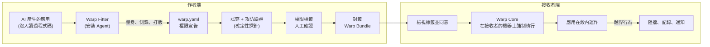

# SecureAIWarp

> 給「沒有人讀過程式碼」的 AI 應用一層可以被信任的**殼**。
> 殼由 AI Agent 量身安裝，但由確定性的核心強制執行，並用一張人看得懂的**權限標籤**交付給他人。

**狀態：規劃階段（v0.1 設計草案）。** 本儲存庫目前只有設計文件，尚無實作。

---

## 一句話說明

現在的 AI 應用常常是這樣做出來的：多個 Agent 協作產生程式碼，人只做測試與功能驗證，不再逐行閱讀。
自己用沒問題；一旦要**交給別人用**，雙方都會開始擔心——

| 誰在擔心 | 擔心什麼 |
| --- | --- |
| 接收者 | 它會不會亂讀我的檔案？把資料傳到哪裡？會不會刪東西？會不會燒光我的 API 額度？ |
| 作者 | 我自己都沒看過程式碼，出事我要負責嗎？金鑰有沒有寫死在裡面？被人濫用怎麼辦？ |
| 組織 / IT | 這東西能不能進公司？依據是什麼？出事查得到紀錄嗎？ |

SecureAIWarp 的回答是：**既然程式碼不可信也沒人看，就不要把信任建立在程式碼上，而是建立在程式碼之外、它碰不到也改不了的邊界上。**

## 核心想法（五句話）

1. **管通道，不管型態。** 應用的介面與實作千變萬化，但它能影響世界的「通道」是有限的：檔案、程序、對外連線、對內連線、機密、AI 呼叫、資料、資源。殼只管這八條通道。
2. **Agent 提案，核心執行。** 因為應用太多樣，殼的設置交給 AI Agent；但 Agent 只能寫出一份宣告式的 `warp.yaml`，真正攔截行為的是一個小而固定、可人工稽核的核心（Warp Core）。Agent 寫錯，最壞結果是「功能不通」，而不是「殼被打穿」。
3. **測試就是規格。** 這群使用者本來就靠測試驗證功能——殼直接重用這些測試：在側錄模式下跑測試得到「它實際需要什麼」，據此產生最小權限；再在強制模式下重跑，證明「加了殼功能仍正常」。
4. **預設拒絕，憑證據授權。** 每一條權限都必須指向一筆側錄證據與一句人話用途。沒有證據的權限不給。
5. **人只看標籤。** 人不看程式碼，也不看 YAML，只看一張像營養標示的**權限標籤**，並對標籤的「差異」做決定。

## 整體流程

關鍵在右半邊：**強制執行發生在接收者自己的 Warp Core 上**。作者交出去的只是一份宣告（資料），不是執法者。接收者不需要相信作者，也不需要相信作者的 Agent。

## 文件導覽

| 文件 | 內容 |
| --- | --- |
| [01 問題與設計原則](docs/01-principles.md) | 為什麼需要殼、八條通道、七項設計原則、殼做不到的事 |
| [02 威脅模型](docs/02-threat-model.md) | 誰可能造成傷害、殼擋得住什麼、明確不處理什麼 |
| [03 架構](docs/03-architecture.md) | Warp Core 的元件、各通道的閘門、隔離後端 |
| [04 權限宣告規格](docs/04-manifest.md) | `warp.yaml` 的結構、檢查規則、風險分數 |
| [05 Agent 安裝協定](docs/05-agent-fitting-protocol.md) | Agent 如何替任意應用裝殼，以及如何防止 Agent 自己出錯或被騙 |
| [06 應用情境與覆蓋率](docs/06-scenarios.md) | CLI、桌面、Web、代管服務、MCP、自主 Agent 等九種情境的套用方式 |
| [07 標籤、封籤與交付](docs/07-label-and-distribution.md) | 權限標籤、信任等級、三種交付模式、版本更新 |
| [08 延伸構想](docs/08-ideas.md) | 試駕模式、後悔藥、保險絲等進一步的點子 |
| [09 路線圖與待決問題](docs/09-roadmap.md) | 分期、MVP 範圍、成功指標、尚未解決的問題 |

另附兩份具體草稿：

- [`examples/invoice-helper.warp.yaml`](examples/invoice-helper.warp.yaml)：一份完整的權限宣告範例
- [`skills/warp-fitter/SKILL.md`](skills/warp-fitter/SKILL.md)：給安裝 Agent 的操作手冊草稿

## 殼能保證與不能保證的事

**能保證（限制爆炸半徑）：** 應用碰不到未宣告的檔案、連不到未宣告的主機、拿不到真正的金鑰、花不超過設定的額度，且所有越界嘗試都有紀錄。

**不能保證（正確性）：** 應用在「被允許的範圍內」做錯事——例如算錯金額、把 A 使用者的資料顯示給 B。殼會縮小這類錯誤的後果，但不會讓錯誤消失。

每張標籤都會誠實標示每條通道的覆蓋程度（強制 / 監看 / 僅聲明 / 無覆蓋），不製造「裝了就安全」的錯覺。

## 命名

專案沿用儲存庫名稱 **SecureAIWarp**，文件中簡稱 **Warp** 或「殼」。指令列工具暫定為 `warp`。
