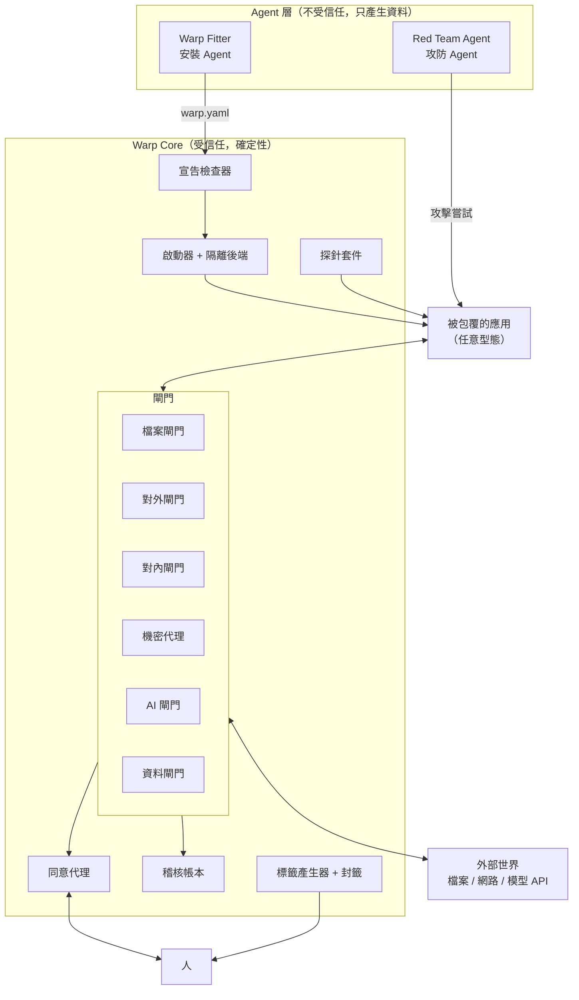
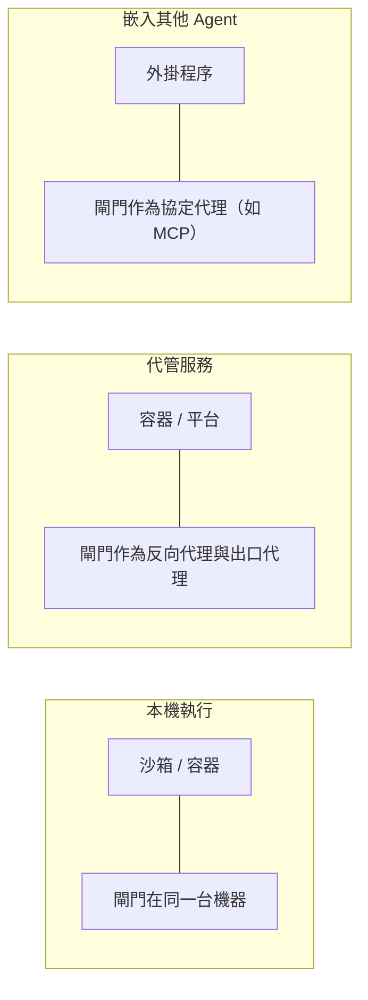

# 03 架構

## 1. 元件總覽

分成三個信任區：

| 區域 | 內容 | 信任程度 |
| --- | --- | --- |
| Agent 層 | Fitter、Red Team Agent | 不信任。只能讀應用、寫 `.warp/` 目錄、呼叫核心的指令 |
| Warp Core | 單一執行檔 `warp` | 信任根。小、確定性、無模型參與 |
| 殼內 | 應用與其相依 | 完全不信任 |

## 2. Warp Core 的元件

### 2.1 啟動器與隔離後端
把應用放進隔離環境並接好各閘門。隔離強度是可選的階梯，宣告檔指定**最低要求**，核心選用主機上可用且不低於要求的後端：

| 等級 | 機制（候選實作） | 適用 | 取捨 |
| --- | --- | --- | --- |
| `process` | 作業系統原生沙箱：Linux 命名空間 + Landlock + seccomp（如 bubblewrap）、macOS 沙箱設定檔、Windows AppContainer | CLI、桌面程式 | 啟動快、可顯示視窗；隔離較弱 |
| `container` | OCI 容器（rootless） | 本機服務、代管服務 | 生態成熟；共用核心 |
| `microvm` | 微型虛擬機或使用者態核心（如 Firecracker、gVisor 類） | 執行不明程式碼、高敏感資料 | 隔離強；資源與相容性成本高 |
| `wasm` | WebAssembly + WASI 能力模型 | 可編譯為 WASM 的工具、外掛 | 最細的能力控管；相容性最受限 |

不重新發明隔離技術。核心的工作是**把同一份宣告翻譯成各後端的設定**，並確保應用的所有通道只能經過閘門。

### 2.2 檔案閘門
- 殼內看到的是一個**合成的檔案系統**：應用自身（唯讀）、專屬資料目錄（可寫）、宣告過的掛載點。家目錄、其他應用的資料、系統憑證目錄根本不存在於殼內。
- 支援 `USER_PICK`：路徑不寫死，由接收者在啟動時選擇資料夾，只有被選的那個會掛進去。
- 可選**覆寫層模式**：所有寫入先落在覆寫層，由使用者檢視後再套用到真實檔案（見 [08 後悔藥](08-ideas.md)）。

### 2.3 對外閘門
殼內**沒有直接的網路**，唯一的出口是對外閘門（代理）。
- 以主機名稱 + 連接埠白名單放行，其餘拒絕並記錄。
- DNS 也由閘門代答，避免用 DNS 夾帶資料。
- 封鎖通往主機本機、區域網路、雲端中繼資料位址的連線，除非明確宣告。
- 流量上限與異常偵測（突然大量上傳）。
- 需要檢視內容時（機密注入、資料規則）以該次安裝專屬的本機憑證中止 TLS；應用若做憑證綁定而無法檢視，該連線降為「僅主機白名單」，標籤上的覆蓋率隨之降級。

### 2.4 對內閘門
應用在殼內不論綁定什麼位址，對外可見性都由閘門決定。
- 預設只開放本機迴路，並自動加上一次性存取權杖，避免本機其他程式或惡意網頁直接打進來。
- 要開放到區域網路或網際網路時，必須選擇驗證方式（權杖、OIDC 等），並可設定頻率限制、每使用者配額、請求大小上限、安全標頭。
- 不宣告的路徑（例如遺留的除錯端點）可以直接在閘門封掉。

### 2.5 機密代理
**應用永遠拿不到真正的金鑰。**
- 殼內的環境變數或設定檔裡只有佔位值。
- 真正的金鑰存在主機的金鑰儲存區，由對外閘門在請求送往**綁定的主機**時才替換進標頭。
- 效果：金鑰印進日誌、被惡意套件讀走、被提示注入騙出來——拿到的都是沒用的佔位值；而且金鑰無法被送往綁定以外的主機。
- 無法以標頭注入的機密（如資料庫密碼、簽章用私鑰）才退回直接提供，此時該機密在標籤上標為「應用可見」。

### 2.6 AI 閘門
針對模型 API 的專用代理，疊在對外閘門之上：
- **花費**：每日／每次／每使用者的金額與 token 上限，超過即熔斷。
- **模型與端點白名單**：防止被改用昂貴模型或未核可的供應商。
- **工具呼叫政策**：應用提供給模型的工具清單與宣告比對；標為高風險的工具（寄信、付款、刪除、執行指令）在執行前經同意代理確認。
- **紀錄**：每次呼叫的中繼資料進帳本（內容是否留存可設定，預設只留雜湊與大小）。
- **MCP 模式**：包覆 MCP 伺服器時，鎖定工具名稱與描述的雜湊，描述被悄悄改動時阻擋並告警。

### 2.7 資料閘門
最難做也最容易誇大的一塊，設計上保守：
- 宣告檔列出應用會處理的資料類別與允許的去向。
- 閘門對可檢視的對外流量做樣式比對（個資樣式、金鑰樣式、接收者預先放入的**誘餌標記**）。
- 定位是**絆線**而非保證：能抓到粗心的外洩與誘餌被送出，抓不到刻意編碼的外洩。標籤上此通道最高只會標到「監看」。

### 2.8 同意代理
執行期需要人決定的時刻都走這裡，並且顯示在**殼的介面**上而非應用的介面上（應用無法偽造或代按）。
- 型別固定：選擇資料夾、提供金鑰、核可高風險工具呼叫、核可一次性的越界請求。
- 無人值守情境可設定為「一律拒絕並記錄」。

### 2.9 稽核帳本
- 所有閘門的決定（放行與拒絕）以附加方式寫入，條目之間以雜湊串接，事後竄改可被發現。
- 存在殼外，應用碰不到。
- 提供人話摘要：「過去 7 天：連線 api.anthropic.com 212 次、花費 3.10 美元、被擋下 2 次對 `~/.ssh` 的讀取」。

### 2.10 宣告檢查器、探針套件、標籤產生器
分別見 [04](04-manifest.md)、[05](05-agent-fitting-protocol.md)、[07](07-label-and-distribution.md)。三者都是確定性程式，沒有模型參與。

## 3. 核心的三種執行模式

| 模式 | 行為 | 用於 |
| --- | --- | --- |
| `record`（側錄） | 在拋棄式環境中放行並記錄一切，但機密是假的、資料是合成的、對外連線被記錄 | 安裝階段，了解應用實際需要什麼 |
| `enforce`（強制） | 只放行宣告內的行為，其餘阻擋並記錄 | 正式使用 |
| `probe`（探測） | 強制模式 + 主動注入越界嘗試，驗證每一項都被擋下 | 安裝階段的驗收、接收者端的複驗 |

側錄模式絕不接觸真實資料與真實金鑰，因為此時應用還沒有任何限制。

## 4. 攔截位置隨情境而變

同一組閘門，接法不同：

各情境的細節與覆蓋率見 [06](06-scenarios.md)。

## 5. 實作取向（建議，非定案）

- **核心語言**：Rust 或 Go，產出單一靜態執行檔，降低核心自身的供應鏈風險。
- **不自造輪子**：隔離、代理、簽章、相依清單、政策引擎都優先採用成熟的開源元件，核心負責整合與翻譯。
- **核心不含模型**：任何需要「判斷」的事都交給 Agent 並以資料形式回到核心檢查。
- **核心可被替換驗證**：規格公開，讓第三方可以寫出相容的核心，避免單點信任。
