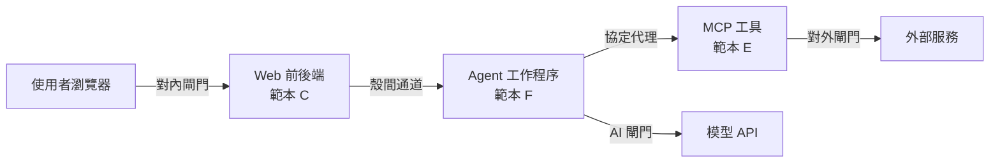

# 06 應用情境與覆蓋率

「涵蓋大部分情境」不是靠為每種應用寫一套防護，而是靠同一組閘門的不同接法。本文列出九種情境範本。實際應用常是複合的（例如「本機網頁 + 自主 Agent」），Fitter 會組合多個範本。

圖例：🟢 強制　🟡 監看　🟠 僅聲明　⚪ 無覆蓋

## 覆蓋率總表

| 情境 | 檔案 | 程序 | 對外 | 對內 | 機密 | AI | 資料 | 供應鏈 |
| --- | :-: | :-: | :-: | :-: | :-: | :-: | :-: | :-: |
| A 命令列工具 / 腳本 | 🟢 | 🟢 | 🟢 | — | 🟢 | 🟢 | 🟡 | 🟢 |
| B 桌面應用 | 🟢 | 🟢 | 🟢 | — | 🟢 | 🟢 | 🟡 | 🟢 |
| C 本機網頁應用 | 🟢 | 🟢 | 🟢 | 🟢 | 🟢 | 🟢 | 🟡 | 🟢 |
| D 代管服務（自行代管） | 🟢 | 🟢 | 🟢 | 🟢 | 🟢 | 🟢 | 🟡 | 🟢 |
| D′ 代管服務（使用者視角） | 🟠 | 🟠 | 🟠 | 🟢 | 🟠 | 🟠 | 🟠 | 🟠 |
| E MCP 伺服器 / Agent 外掛 | 🟢 | 🟢 | 🟢 | 🟢 | 🟢 | 🟢 | 🟡 | 🟢 |
| F 自主 Agent / 多 Agent | 🟢 | 🟢 | 🟢 | 🟢 | 🟢 | 🟢 | 🟡 | 🟢 |
| G 排程與資料管線 | 🟢 | 🟢 | 🟢 | — | 🟢 | 🟢 | 🟡 | 🟢 |
| H 聊天機器人 / 無伺服器函式 | 🟡 | 🟡 | 🟢 | 🟢 | 🟢 | 🟢 | 🟡 | 🟢 |
| I 瀏覽器外掛 / 行動應用 | ⚪ | ⚪ | 🟡 | — | 🟠 | 🟡 | 🟠 | 🟢 |

資料通道最高只到 🟡，理由見 [03 資料閘門](03-architecture.md)。

---

## A　命令列工具 / 腳本
**例**：批次改檔名的 Python 腳本、整理報表的 CLI。

- **接法**：`process` 隔離。合成檔案系統，只掛入使用者指定的工作目錄。
- **特有風險**：這類工具最常「順手」掃描或刪除範圍過大的檔案。
- **建議預設**：對使用者資料夾開啟覆寫層模式——先看變更清單再套用。
- **使用體驗**：`warp run tool.warp -- <原本的參數>`，與原本用法幾乎相同。

## B　桌面應用
**例**：Electron、Tauri、原生 GUI 工具。

- **接法**：`process` 隔離並放行視窗顯示所需的系統介面。檔案選擇對話框由同意代理提供，選到的檔案才進殼。
- **特有風險**：剪貼簿、螢幕擷取、攝影機麥克風、自動更新機制。
- **處理**：裝置權限逐項宣告；應用內建的自動更新預設封鎖，更新一律走重新封籤的 Bundle。
- **難點**：三大作業系統的沙箱機制差異大，圖形與輸入法相容性需要逐平台處理，是覆蓋率最容易打折的情境。

## C　本機網頁應用
**例**：Streamlit、Gradio、本機跑的 FastAPI + 前端。

- **接法**：`container` 隔離。應用在殼內隨意綁定，對內閘門決定實際開放範圍。
- **特有風險**：綁在所有網卡且無驗證；被使用者瀏覽的惡意網頁跨站打進本機服務。
- **建議預設**：只開本機迴路 + 自動帶入的一次性權杖 + 來源檢查。
- **使用體驗**：`warp run` 後自動開啟帶權杖的網址。

## D　代管服務
**例**：部署在雲端給多人使用的 Web 應用或 API。

兩個視角要分開看：

**D（作者 / 營運者視角）**——殼跑在作者控制的基礎設施上，保護作者與其使用者。
- **接法**：容器 + 對內閘門作為反向代理 + 對外閘門作為唯一出口；可翻譯成平台原生的網路政策。
- **特有風險**：公開暴露、多租戶、錢包阻斷、使用者上傳的內容成為提示注入來源。
- **閘門重點**：身分驗證、每使用者頻率與花費配額、請求大小上限、安全標頭、對外白名單（就算應用被打穿也無處外傳）、金鑰不進應用。
- **殼做不到**：租戶之間的資料隔離是應用邏輯。殼可以建議「每租戶一個殼實例」的部署方式把這件事變成基礎設施層的隔離，但成本較高。

**D′（使用者視角）**——使用者無法在別人的伺服器上執法。
- 只有對內連線（使用者自己的瀏覽器到服務）在使用者掌控中。
- 其餘通道只能依靠作者公開的標籤與證明，因此都是 🟠。
- 提升可信度的途徑見 [07 代管交付](07-label-and-distribution.md)。

## E　MCP 伺服器 / Agent 外掛 / 技能包
**例**：給編碼 Agent 或聊天助理使用的工具伺服器。

- **接法**：殼包住伺服器程序（檔案、網路、機密照常管控），同時在主機 Agent 與伺服器之間放協定代理。
- **特有風險**：
  - 工具描述夾帶對模型的指令（工具投毒）。
  - 通過審核後悄悄更改工具描述或行為。
  - 取得主機 Agent 的過大權限，成為跳板。
  - 工具回傳內容夾帶注入。
- **閘門重點**：鎖定工具清單與描述的雜湊；工具依風險分級並可逐項要求同意；回傳內容大小上限；伺服器看不到主機 Agent 的其他憑證。
- **為什麼重要**：這是目前「把 AI 做的東西給別人裝」最頻繁的形式，建議列為優先支援。

## F　自主 Agent / 多 Agent 系統
**例**：會自己規劃、呼叫工具、長時間執行的 Agent。

- **接法**：`container` 或 `microvm`。所有模型呼叫經 AI 閘門，所有工具執行受殼的通道限制。
- **特有風險**：行為空間開放，側錄無法窮舉；提示注入的後果最大；長時間執行造成費用與副作用累積。
- **處理**：
  - 接受「側錄不完整」——權限以**任務範圍**宣告（這個 Agent 的工作區、可連的服務），而非逐一列舉行為。
  - 高風險動作一律經同意代理；無人值守時預設拒絕。
  - 花費、步數、執行時間三重保險絲。
  - 多 Agent 時每個角色可以有自己的殼：研究 Agent 能上網但碰不到檔案，執行 Agent 能改檔案但不能上網——即使其中一個被注入，也湊不齊「讀到機密 + 送出去」的組合。

## G　排程與資料管線
**例**：每天抓資料、轉換、寫入資料庫的工作。

- **接法**：`container`，無對內連線，無人值守。
- **特有風險**：沒有人在看；持有資料庫等長期憑證。
- **處理**：同意代理設為一律拒絕；資料庫憑證盡量以代理方式提供，不行則列為 `app-visible` 例外並建議使用權限最小的資料庫帳號；帳本摘要定期送出。

## H　聊天機器人 / 無伺服器函式
**例**：LINE、Discord、Slack 機器人；雲端函式。

- **接法**：能自帶容器的平台同 D；純函式平台則無法在程序層隔離，改以對外代理 + 平台的權限設定實現。
- **覆蓋率**：檔案與程序降為 🟡（依賴平台本身的隔離，殼只能檢查設定）。
- **特有風險**：Webhook 未驗證簽章；任何群組成員都能觸發昂貴操作。
- **閘門重點**：對內閘門驗證平台簽章、每使用者配額。

## I　瀏覽器外掛 / 行動應用
**例**：Chrome 擴充功能、iOS / Android 應用。

- 這類應用跑在平台自己的沙箱裡，外部的殼**插不進去**，必須誠實承認覆蓋有限。
- **殼能做的**：
  - 把平台的權限宣告翻譯成 Warp 標籤，並檢查是否超出側錄觀察到的需要（靜態 + 測試環境中的動態觀察）。
  - 供應鏈檢查照常。
  - 若有後端，後端以情境 D 完整包覆——通常真正的金鑰與資料都在那裡。
  - 建議架構：前端不持有任何金鑰，一律經由被殼保護的後端。
- **標籤**：明確標示「執行期保護由平台提供，非 Warp 強制」。

---

## 複合應用的處理

Fitter 把應用拆成**元件**，各自套用範本，並宣告元件之間的通道：

元件之間的連線也是需要宣告的通道。拆得越細，單一元件被攻破時的損害越小；但複雜度越高。Fitter 的預設是：**能上網的元件與能碰敏感資料的元件，盡量不要是同一個。**
