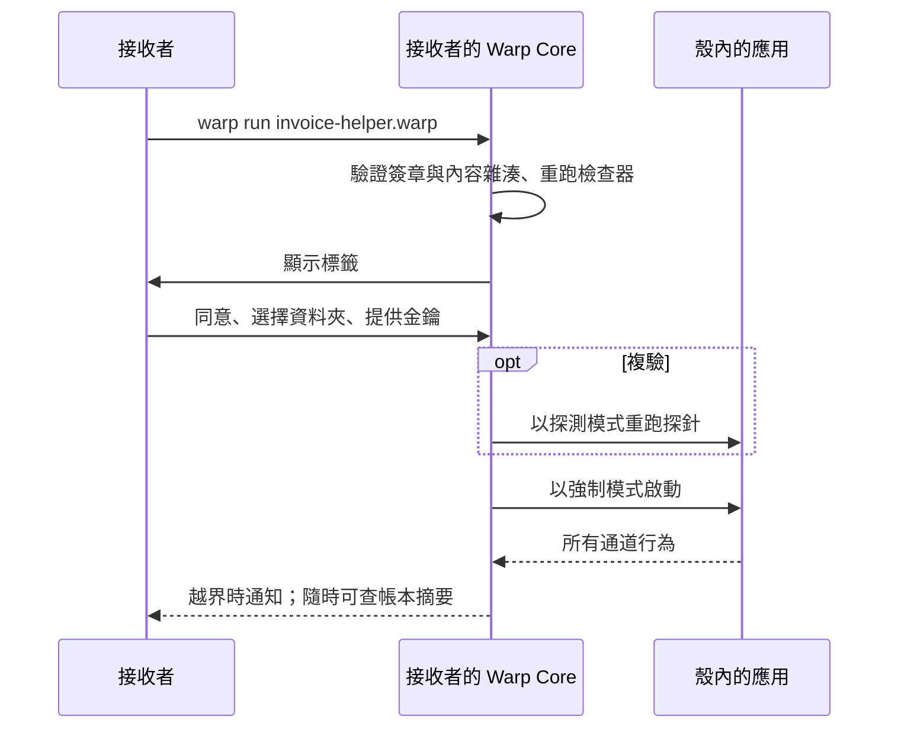

# 07 標籤、封籤與交付

## 1. 權限標籤

標籤是人與殼之間唯一的介面。它由核心從宣告機械式產生，Agent 無法更動事實欄位。

```
┌──────────────────────────────────────────────────────────────┐
│  發票小幫手  v1.4.0                         風險等級：低 (18) │
│  型態：本機網頁應用          隔離：容器                       │
├──────────────────────────────────────────────────────────────┤
│  這個工具可以                                                 │
│   📁 讀取   你選定的一個資料夾（發票）                        │
│   📁 讀寫   自己的資料目錄                                    │
│   🌐 連線   api.anthropic.com      分析發票內容               │
│   🌐 連線   api.frankfurter.app    查詢匯率                   │
│   🔑 使用   你的 Anthropic 金鑰（工具本身看不到金鑰）         │
│   🤖 AI     每日上限 5 美元                                   │
│   🚪 開放   僅本機，需權杖                                    │
├──────────────────────────────────────────────────────────────┤
│  這個工具不可以                                               │
│   ✖ 存取其他檔案　✖ 連到其他網站　✖ 連到你的內部網路        │
│   ✖ 執行其他程式　✖ 在背景常駐                              │
├──────────────────────────────────────────────────────────────┤
│  需要你特別注意                                               │
│   （無例外）                                                  │
├──────────────────────────────────────────────────────────────┤
│  保護程度   檔案🟢 程序🟢 對外🟢 對內🟢 機密🟢 AI🟢 資料🟡   │
│  驗證       探針 23/23 被擋下 ｜ 功能測試 41/41 通過          │
│  相依套件   87 個，無已知高風險漏洞（檢查於 2026-11-20）      │
│  信任等級   L2 已驗證                                         │
│  作者說明   「協助整理發票並換算幣別」  ← 未經驗證的自述      │
└──────────────────────────────────────────────────────────────┘
```

設計要點：

- **「不可以」與「可以」同樣重要**——這是功能測試給不了的負向保證。
- **事實與自述分開**：主機、路徑、額度來自宣告並由核心執行；用途文字是作者或 Agent 寫的，明確標為未驗證。
- **例外獨立成區**，空的時候也顯示，讓「沒有例外」成為可見的資訊。
- **覆蓋率直接列出**，不藏在細節裡。
- 提供機器可讀版本（JSON），讓接收者的 Agent 或組織的政策可以自動判讀：例如「公司只允許 L2 以上、無 `app-visible` 機密、對外主機在核可清單內的工具」。

## 2. 信任等級

| 等級 | 名稱 | 條件 | 意義 |
| --- | --- | --- | --- |
| L0 | 已盤點 | 完成靜態盤點與供應鏈檢查 | 知道它是什麼做的；尚無執行期保護 |
| L1 | 已包覆 | 有通過檢查器的宣告，可在強制模式執行 | 行為被限制在宣告內 |
| L2 | 已驗證 | L1 + 功能測試在強制模式下通過 + 確定性探針全數被擋 | 有證據顯示殼確實有效且不影響功能（第 1 期：依據是本機報告檔，同一個使用者可偽造；要確認請自己執行 `warp probe`） |
| L3 | 已見證 | L2 + 可重現建置 + 由獨立方（接收者自己、組織、第三方）重跑驗證並副署 | 不需相信作者的說法 |

等級描述的是**證明的強度**，不是應用的好壞。一個 L3 的工具仍然可能要求很大的權限——那會顯示在風險等級與例外上。兩個維度分開看。

## 3. Warp Bundle

封籤產物，一個可攜的封裝：

```
invoice-helper-1.4.0.warp
├── app/                    應用內容（或其映像檔的雜湊參照）
├── warp.yaml               權限宣告
├── label.json              機器可讀標籤
├── sbom.json               相依清單
├── reports/
│   ├── survey.json         盤點摘要
│   ├── fit.json            試穿結果
│   └── probe.json          探針結果
├── evidence/               側錄證據摘要（已去除內容，只留行為）
├── exceptions.json         例外簽核紀錄
└── signature               對以上所有內容雜湊的簽章
```

Bundle **不含**任何金鑰、不含真實資料、不含執法元件。

## 4. 三種交付模式

### 模式一：本機交付（最強）
接收者在自己的機器上，用自己安裝的 Warp Core 執行 Bundle。



- 接收者信任的只有自己的核心。作者的宣告即使不實，也只會導致功能不通。
- 核心在接收者端**重新執行檢查器**，不採信 Bundle 裡自稱的檢查結果。
- 探針可以在接收者端重跑（L2 → 自行見證的 L3）。

### 模式二：代管交付（最弱，需誠實）
作者把應用部署成服務，其他人透過瀏覽器或 API 使用。使用者無法在作者的伺服器上執法。

殼此時的價值分兩層：

1. **對作者**：完整的情境 D 保護——限制被攻破時的損害、控制費用、留下紀錄。這本身就大幅降低使用者資料出事的機率。
2. **對使用者**：透明度而非強制力。
   - 服務公開一份標籤（建議位置：`/.well-known/warp-label.json`），說明資料去向、留存、第三方。
   - 標籤上的覆蓋率如實顯示為「僅聲明」。
   - 提升可信度的階梯：作者自述 → 第三方稽核副署 → 部署於可遠端證明的環境（機密運算），由硬體證明「跑的確實是這份 Bundle 與這份宣告」。後者列為遠期目標。

對高敏感用途，文件應直接建議：**改用模式一，或由使用者的組織自行代管。**

### 模式三：嵌入交付
應用作為外掛裝進另一個主機 Agent（MCP 伺服器、技能包）。

- 執法者是**主機端**的 Warp Core 與協定代理。
- 主機 Agent 的安裝流程可以直接讀取機器可讀標籤，依組織政策自動決定接受、拒絕或提請人工確認。
- 這是 Agent 對 Agent 的交付，標籤的機器可讀性在此最關鍵。

## 5. 更新

更新是信任最容易被悄悄侵蝕的時刻（審核時無害，更新後變質）。

- 任何內容變動都使原封籤失效——核心比對雜湊，不符即拒絕執行。
- 新版本必須重走側錄、試穿、攻防並重新封籤。
- 接收者端：
  - **權限不變或縮小** → 可設定為自動接受。
  - **權限擴大** → 顯示[版本差異](04-manifest.md)，需重新同意。
  - **信任等級下降** → 預設拒絕。
- 應用內建的自我更新機制一律封鎖。

## 6. 撤銷與事後追查

- 作者或見證方可以發布撤銷聲明（某版本發現問題）；核心在啟動時檢查。
- 接收者隨時可以停止執行並撤回已提供的金鑰——因為金鑰從未進入應用，撤回是即時且完整的。
- 帳本可匯出，供事後釐清「它實際上做過什麼」。這也是對作者的保護：出事時有客觀紀錄，而不是各說各話。

## 7. 責任的重新分配

殼不會讓責任消失，但會讓它變得清楚：

| 角色 | 殼之前 | 殼之後 |
| --- | --- | --- |
| 作者 | 對沒看過的程式碼負無限責任 | 對一張自己確認過的標籤負責 |
| 接收者 | 只能選擇全信或不用 | 對自己同意的權限範圍負責 |
| 組織 | 只能全面禁止或睜一隻眼閉一隻眼 | 可以用政策條件式放行 |
